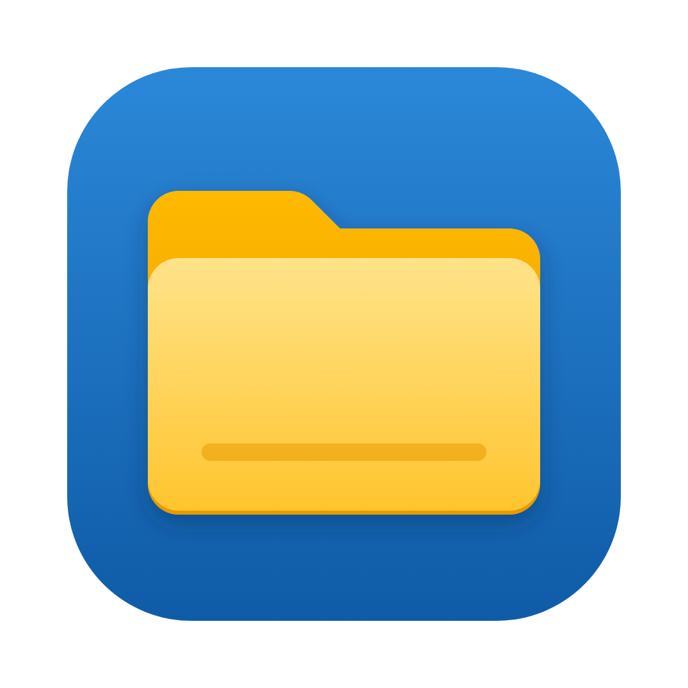

# File Explorer for macOS

A Windows 11–style File Explorer for the Mac, built with Electron. It works on your real macOS file system and behaves the way Windows Explorer does.



## Download

Every push builds a **universal DMG** (Intel + Apple Silicon) on a macOS runner via GitHub Actions:

- **Releases** page → download `File-Explorer-<version>-universal.dmg`
- or the **Actions** tab → latest *Build macOS DMG* run → artifact `File-Explorer-macOS`

Open the DMG and drag **File Explorer** onto **Applications**.

> The app is ad-hoc signed, not notarized (that needs a paid Apple Developer ID). On first launch macOS will block it. Either right-click the app → **Open** → **Open**, or run:
> ```bash
> xattr -cr "/Applications/File Explorer.app"
> ```
> To browse protected folders such as the Recycle Bin (`~/.Trash`), grant **Full Disk Access** in System Settings → Privacy & Security.

## Features

**Windows 11 layout**
- Tabs in the title bar (new / duplicate / close others / move to new window, middle-click to close, drag files onto a tab)
- Back / Forward (right-click for history) / Up / Refresh, mouse back/forward buttons
- Breadcrumb address bar with subfolder drop-downs, overflow «, click to type a path (Tab completion, `~`, relative paths, names like `Downloads`, `This PC`)
- Search box: live recursive search of the current folder, with `*` and `?` wildcards
- Command bar: New ▾, Cut, Copy, Paste, Rename, Share, Delete, Sort ▾, View ▾, Extract all, Empty Recycle Bin, "See more" (…), Details/Preview pane toggle
- Navigation pane: Home, pinned Quick access folders, your user folder, This PC (drives and volumes, with eject), Recycle Bin. Expandable tree with lazy loading.
- **Home**: Quick access tiles and Recent files. **This PC**: special folders, and drives with capacity bars.
- Status bar showing item and selection counts and size, plus quick view toggles

**Views**: Extra large, Large, Medium and Small icons, List, Details, Tiles, Content. Compact mode. Each folder remembers its own view, sort and grouping. ⌘+scroll changes icon size.
- Details view: sortable, resizable columns (double-click a divider to auto-fit); right-click the header to show or hide Date created, Date accessed and other columns
- Group by Name, Date modified (Today / Yesterday / Last week …), Type or Size (Tiny / Small / Medium …), with collapsible groups
- Real thumbnails from macOS Quick Look, native file-type icons, Windows-style coloured folder icons

**File operations**
- Copy, cut and paste, which also work with Finder in both directions. Paste shortcut (alias).
- Drag and drop within the app and to and from Finder and other apps. Same drive moves, other drive copies, hold ⌥ to force a copy. Spring-loaded folders.
- Replace / Skip / Keep both dialog for name conflicts. Windows "– Copy" naming when pasting into the same folder.
- Progress panel with cancel for long copies and moves
- Delete to Recycle Bin (Trash), permanent delete (⇧Delete), Empty Recycle Bin
- **Undo / Redo** for rename, move, copy, new item and delete
- Inline rename (F2; Tab renames the next item; warns before you change the extension)
- New folder, text, RTF, Markdown, HTML, shell script, empty ZIP, shortcut
- Compress to ZIP and Extract All / Extract to…
- Open, Open with…, Open in new tab or window, Open in Terminal, Show in Finder, Copy as path, Pin to Quick access

**Panes and dialogs**
- Preview pane: images, video, audio, PDF, text and code, HTML, and Quick Look for everything else
- Details pane: metadata, dimensions, folder size
- Space bar opens a peek (Quick Look style) overlay; use the arrow keys to step through items
- Properties dialog with General, Security (permissions) and Details tabs, including folder size, size on disk, Read-only and Hidden attributes, and a drive usage pie chart
- Folder Options: start page, light/dark/system theme, open folders in new tabs, hidden files, file extensions, item check boxes, clear history, reset folder views

**Selection**: click, ⌘-click, ⇧-click, rubber-band (marquee), item check boxes, Select all / none / invert, arrow-key navigation in every view, type-ahead to jump to a name.

Press **F1** in the app for the full keyboard shortcut list.

## Develop

```bash
npm install
npm start          # run the app
npm run dist       # build dist/File-Explorer-<version>-universal.dmg (macOS only)
npm run icon       # regenerate build/icon.icns from build/icon.svg
```
